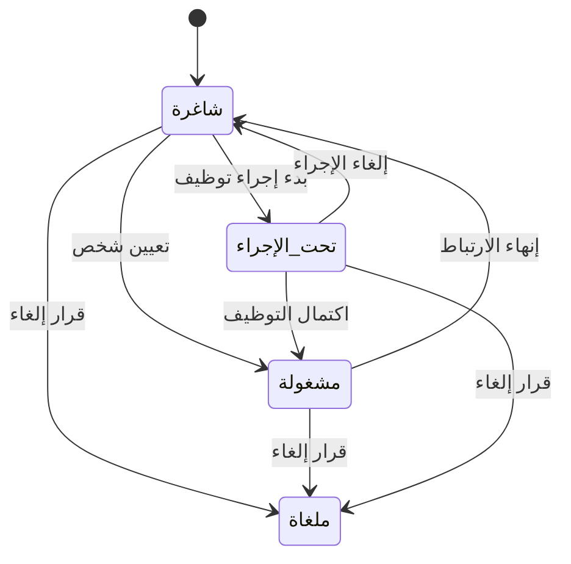
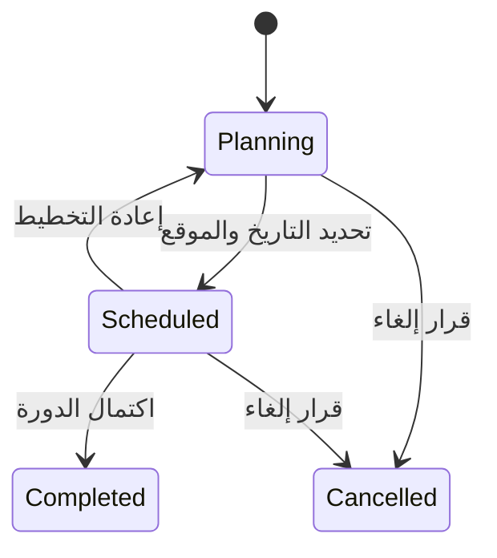
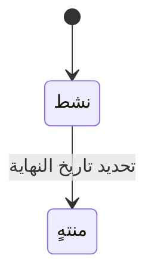
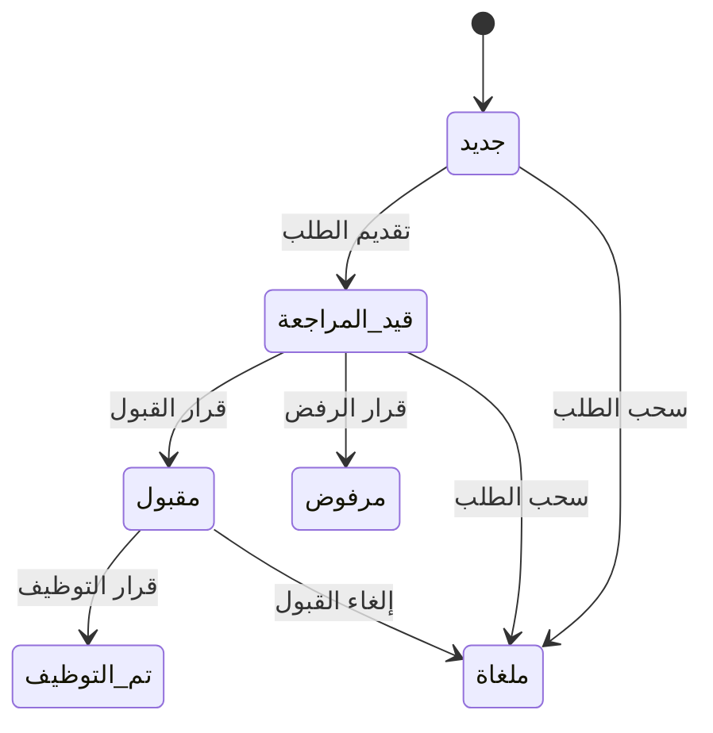
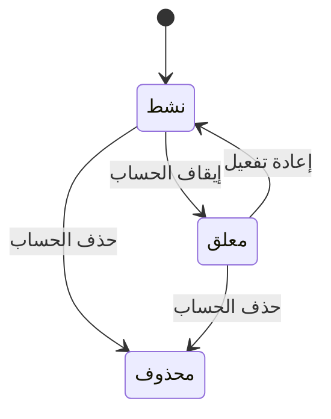
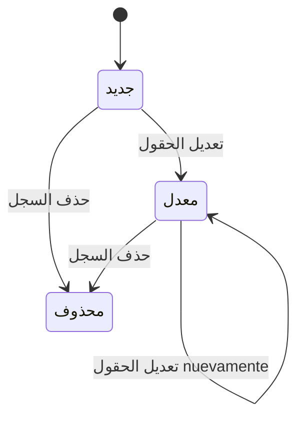
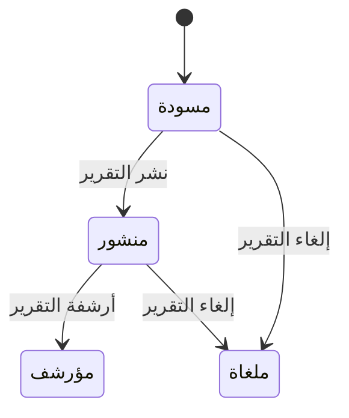

# دورات حياة العمليات (IHRIS Legacy Workflows)

## 1. نظرة عامة

تم استنتاج دورات حياة العمليات من تحليل جداول قاعدة البيانات القديمة، وحقول الحالات، والعلاقات بين الجداول. النظام يدعم عدة دورات حياة للعمليات الرئيسية.

---

## 2. دورة حياة الوظيفة (Position Lifecycle)

### 2.1 الحالات والانتقالات

| الحالة | الوصف | الانتقالات المسموحة | شروط الانتقال | الجهة المسؤولة |
|--------|-------|-------------------|---------------|--------------|
| شاغرة (Vacant) | الوظيفة متاحة للتوظيف ولا يشغلها أي شخص | → مشغولة، → ملغاة | تعيين شخص للوظيفة، قرار بالإلغاء | hr_manager, hr_staff |
| مشغولة (Filled) | الوظيفة مشغولة بشخص معين | → شاغرة، → ملغاة | إنهاء ارتباط الشخص بالوظيفة، قرار بالإلغاء | hr_manager, hr_staff |
| تحت الإجراء (In Process) | الوظيفة في مرحلة التوظيف أو الإجراء | → شاغرة، → مشغولة، → ملغاة | اكتمال الإجراء، إلغاء الإجراء | hr_manager |
| ملغاة (Cancelled) | الوظيفة ملغاة ولا يمكن شغلها | لا انتقالات | لا ينطبق | hr_manager |

### 2.2 مخطط آلة الحالة (State Machine)

### 2.3 الكيانات والجداول المرتبطة

| الجدول | الغرض | الحقول المهمة |
|--------|-------|-------------|
| hippo_position | تعريف الوظيفة | id, code, title, status, facility, department, job, supervisor, proposed_salary, posted_date |
| hippo_pos_change_reason | أسباب تغيير حالة الوظيفة | id, name |
| hippo_person_position | ارتباط الشخص بالوظيفة | id, person_id, position_id, start_date, end_date, reason |
| hippo_position_decision | قرارات الوظائف | id, position_id, decision_date, offer, comments |
| hippo_position_interview | مقابلات الوظائف | id, position_id, interview_date, person, comments |

---

## 3. دورة حياة الدورة التدريبية (Training Course Lifecycle)

### 3.1 الحالات والانتقالات

| الحالة | الوصف | الانتقالات المسموحة | شروط الانتقال | الجهة المسؤولة |
|--------|-------|-------------------|---------------|--------------|
| مجدولة (Scheduled) | الدورة مجدولة للتسجيل | → مكتملة، → ملغاة، → قيد التخطيط | اكتمال الدورة، قرار بالإلغاء، إعادة التخطيط | training_manager |
| مكتملة (Completed) | الدورة انتهت بنجاح | لا انتقالات | لا ينطبق | training_manager |
| ملغاة (Cancelled) | الدورة ملغاة | لا انتقالات | لا ينطبق | training_manager |
| قيد التخطيط (Planning) | الدورة قيد التخطيط | → مجدولة، → ملغاة | تحديد تاريخ وموقع، قرار بالإلغاء | training_manager |

### 2.2 مخطط آلة الحالة (State Machine)

### 2.3 الكيانات والجداول المرتبطة

| الجدول | الغرض | الحقول المهمة |
|--------|-------|-------------|
| hippo_training_course | تعريف الدورة التدريبية | id, name, topic, notes, training_institution, training_course_status, training_course_category, competency |
| hippo_training_course_status | حالات الدورة | id, name |
| hippo_training_course_category | تصنيفات الدورة | id, name |
| hippo_training_institution | مؤسسات التدريب | id, name |
| hippo_training_funder | ممولي التدريب | id, name |
| hippo_scheduled_training_course | الدورات المجدولة | id, training_course, site, num_students, start_date, end_date, country, district, county |
| hippo_person_scheduled_training_course | تدريب الأشخاص | id, person_id, scheduled_training_course_id, is_retraining, completed, request_date, notes |

---

## 4. دورة حياة الشخص في الوظيفة (Person-Position Lifecycle)

### 4.1 الحالات والانتقالات

| الحالة | الوصف | الانتقالات المسموحة | شروط الانتقال | الجهة المسؤولة |
|--------|-------|-------------------|---------------|--------------|
| نشط (Active) | الشخص يشغل الوظيفة حالياً | → منتهٍ | تحديد تاريخ نهاية (end_date) | hr_manager, hr_staff |
| منتهٍ (Ended) | الشخص انتهى من الوظيفة | لا انتقالات | لا ينطبق | hr_manager, hr_staff |

### 4.2 مخطط آلة الحالة (State Machine)

### 4.3 الكيانات والجداول المرتبطة

| الجدول | الغرض | الحقول المهمة |
|--------|-------|-------------|
| hippo_person_position | ارتباط الشخص بالوظيفة | id, person_id, position_id, start_date, end_date, reason |
| hippo_person | بيانات الشخص | id, surname, firstname, othername, nationality, country, district, county |
| hippo_position | بيانات الوظيفة | id, code, title, status, facility, department |

---

## 5. دورة حياة طلب التوظيف (Application Lifecycle)

### 5.1 الحالات والانتقالات

| الحالة | الوصف | الانتقالات المسموحة | شروط الانتقال | الجهة المسؤولة |
|--------|-------|-------------------|---------------|--------------|
| جديد (New) | طلب توظيف جديد تم إنشاؤه | قيد المراجعة، ملغاة | تقديم الطلب، سحب الطلب | hr_staff, hr_manager |
| قيد المراجعة (Under Review) | الطلب قيد المراجعة | مقبول، مرفوض، ملغاة | مراجعة الطلب، قرار بالرفض، سحب الطلب | hr_manager |
| مقبول (Accepted) | الطلب مقبول | تم التوظيف، ملغاة | قرار التوظيف، إلغاء القبول | hr_manager |
| مرفوض (Rejected) | الطلب مرفوض | لا انتقالات | لا ينطبق | hr_manager |
| تم التوظيف (Hired) | تم توظيف المتقدم | لا انتقالات | لا ينطبق | hr_manager |
| ملغاة (Cancelled) | الطلب ملغى | لا انتقالات | لا ينطبق | hr_staff, hr_manager |

### 5.2 مخطط آلة الحالة (State Machine)

### 5.3 الكيانات والجداول المرتبطة

| الجدول | الغرض | الحقول المهمة |
|--------|-------|-------------|
| hippo_application | طلبات التوظيف | id, person_id, position_id, felony, felony_circumstance, other_info, hear, start_date, desired_wage, full_time, hours |
| hippo_person | بيانات الشخص | id, surname, firstname, othername, nationality, country, district, county |
| hippo_position | بيانات الوظيفة | id, code, title, status, facility, department |

---

## 6. دورة حياة مستخدم النظام (User Lifecycle)

### 6.1 الحالات والانتقالات

| الحالة | الوصف | الانتقالات المسموحة | شروط الانتقال | الجهة المسؤولة |
|--------|-------|-------------------|---------------|--------------|
| نشط (Active) | المستخدم نشط ويمكنه تسجيل الدخول | → معلق، → محذوف | إيقاف الحساب، حذف الحساب | admin |
| معلق (Suspended) | الحساب معلق مؤقتاً | → نشط، → محذوف | إعادة تفعيل الحساب، حذف الحساب | admin |
| محذوف (Deleted) | الحساب محذوف نهائياً | لا انتقالات | لا ينطبق | admin |

### 6.2 مخطط آلة الحالة (State Machine)

### 6.3 الكيانات والجداول المرتبطة

| الجدول | الغرض | الحقول المهمة |
|--------|-------|-------------|
| user | المستخدمين | id, username, password, firstname, lastname, email, creator |
| access | الأدوار | user, role |
| user_log | سجل النشاط | user, login, logout, session_id, activity |

---

## 7. دورة حياة السجل الديناميكي (EAV Record Lifecycle)

### 7.1 الحالات والانتقالات

| الحالة | الوصف | الانتقالات المسموحة | شروط الانتقال | الجهة المسؤولة |
|--------|-------|-------------------|---------------|--------------|
| جديد (New) | سجل جديد تم إنشاؤه | معدل، محذوف | تعديل الحقول، حذف السجل | أي مستخدم لديه صلاحية تعديل |
| معدل (Modified) | سجل تم تعديله | معدل، محذوف | تعديل الحقول، حذف السجل | أي مستخدم لديه صلاحية تعديل |
| محذوف (Deleted) | سجل محذوف ناعمًا | لا انتقالات | لا ينطبق | أي مستخدم لديه صلاحية حذف |

### 7.2 المخطط

### 7.3 الكيانات والجداول المرتبطة

| الجدول | الغرض | الحقول المهمة |
|--------|-------|-------------|
| record | السجلات الفعلية | id, last_modified, form, parent |
| entry | قيم الحقول | record, form_field, date, who, change_type, string_value, integer_value, text_value, date_value, blob_value |
| last_entry | آخر إدخال مخبأ | record, form_field, date, who, change_type, string_value, integer_value, text_value, date_value, blob_value |
| deleted_record | السجلات المحذوفة | id, last_modified, form, parent |

---

## 8. دورة حياة التقرير المخصص (Custom Report Lifecycle)

### 8.1 الحالات والانتقالات

| الحالة | الوصف | الانتقالات المسموحة | شروط الانتقال | الجهة المسؤولة |
|--------|-------|-------------------|---------------|--------------|
| مسودة (Draft) | تقرير جديد تم إنشاؤه | منشور، ملغاة | نشر التقرير، إلغاء التقرير | hr_manager, exec_manager |
| منشور (Published) | التقرير منشور ومتاح للعرض | مؤرشف، ملغاة | أرشفة التقرير، إلغاء التقرير | hr_manager, exec_manager |
| مؤرشف (Archived) | التقرير مؤرشف | لا انتقالات | لا ينطبق | hr_manager, exec_manager |
| ملغاة (Cancelled) | التقرير ملغى | لا انتقالات | لا ينطبق | hr_manager, exec_manager |

### 8.2 المخطط

### 8.3 الكيانات والجداول المرتبطة

| الجدول | الغرض | الحقول المهمة |
|--------|-------|-------------|
| config | إعدادات التقارير المخصصة | hash, path, type, value, children (مسارات CustomReports/reports/*) |
| report | التقارير (في النظام الحديث) | id, type, report, cached, status |

---

## 9. قاعدة العمل لكل دورة حياة

### 9.1 قواعد دورة حياة الوظيفة

| القاعدة | معرف | الوصف | مصدر الدليل |
|--------|-------|-------|-------------|
| BL-001 | POSITION_CANNOT_BE_FILLED_IF_CANCELLED | لا يمكن شغل وظيفة ملغاة | تحليل جدول hippo_pos_change_reason |
| BR-002 | POSITION_CANNOT_BE_VACANT_IF_FILLED | لا يمكن أن تكون وظيفة شاغرة إذا كان بها شخص مرتبط | تحليل جدول hippo_person_position |
| BR-003 | POSITION_REQUIRES_VALID_STATUS | يجب أن تكون لكل وظيفة حالة صالحة | تحليل جدول hippo_position.status |

### 9.2 قواعد دورة حياة الدورة التدريبية

| القاعدة | معرف | الوصف | مصدر الدليل |
|--------|-------|-------|-------------|
| BR-004 | TRAINING_CANNOT_START_IF_NOT_SCHEDULED | لا يمكن بدء دورة غير مجدولة | تحليل جدول hippo_training_course_status |
| BR-005 | TRAINING_COMPLETION_REQUIRES_STUDENTS | إكمال الدورة يتطلب وجود متدربين | تحليل جدول hippo_person_scheduled_training_course |

### 9.3 قواعد دورة حياة الشخص في الوظيفة

| القاعدة | معرف | الوصف | مصدر الدليل |
|--------|-------|-------|-------------|
| BR-006 | PERSON_CANNOT_HAVE_OVERLAPPING_POSITIONS | لا يمكن أن يشغل شخص وظيفتين في نفس الوقت (بناءً على start_date و end_date) | تحليل جدول hippo_person_position |
| BR-007 | POSITION_END_DATE_REQUIRED_FOR_TERMINATION | إنهاء وظيفة يتطلب تحديد تاريخ النهاية | تحليل جدول hippo_person_position.end_date |

### 9.4 قواعد دورة حياة طلب التوظيف

| القاعدة | معرف | الوصف | مصدر الدليل |
|--------|-------|-------|-------------|
| BR-008 | APPLICATION_REQUIRES_PERSON_AND_POSITION | طلب التوظيف يتطلب تحديد الشخص والوظيفة | تحليل جدول hippo_application |
| BR-009 | APPLICATION_CANNOT_BE_ACCEPTED_IF_POSITION_FILLED | لا يمكن قبول طلب توظيف لوظيفة مشغولة | تحليل جداول hippo_application و hippo_position |

### 9.5 قواعد دورة حياة المستخدم

| القاعدة | معرف | الوصف | مصدر الدليل |
|--------|-------|-------|-------------|
| BR-010 | USER_MUST_HAVE_UNIQUE_USERNAME | يجب أن يكون لكل مستخدم اسم مستخدم فريد | UNIQUE KEY username في جدول user |
| BR-011 | USER_MUST_HAVE_ROLE | يجب أن يكون لكل مستخدم دور واحد على الأقل | وجود جدول access |

---

## 10. مصفوفة الأدلة

| الدورة | الجداول المرتبطة | مستويات الثقة |
|-------|-------------|-------------|
| الوظيفة | hippo_position, hippo_pos_change_reason, hippo_person_position, hippo_position_decision, hippo_position_interview | مرجحة |
| الدورة التدريبية | hippo_training_course, hippo_training_course_status, hippo_training_course_category, hippo_training_institution, hippo_scheduled_training_course, hippo_person_scheduled_training_course | مرجحة |
| الشخص في الوظيفة | hippo_person_position, hippo_person, hippo_position | مرجحة |
| طلب التوظيف | hippo_application, hippo_person, hippo_position | مرجحة |
| المستخدم | user, access, user_log | مؤكدة |
| السجل الديناميكي | record, entry, last_entry, deleted_record | مؤكدة |
| التقرير المخصص | config (مسارات CustomReports/*) | مرجحة |

---
